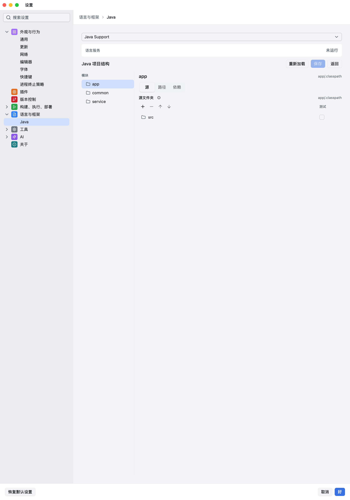
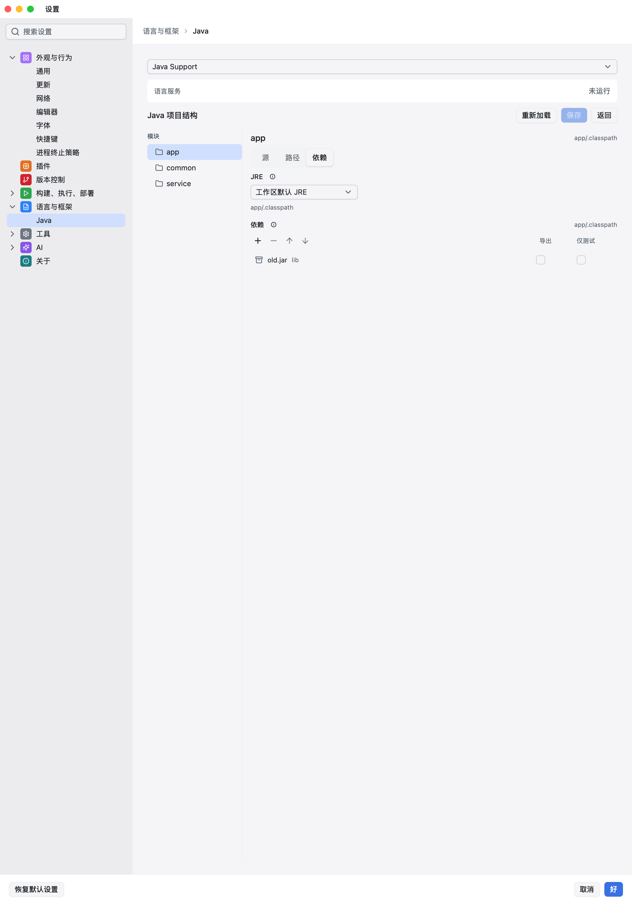
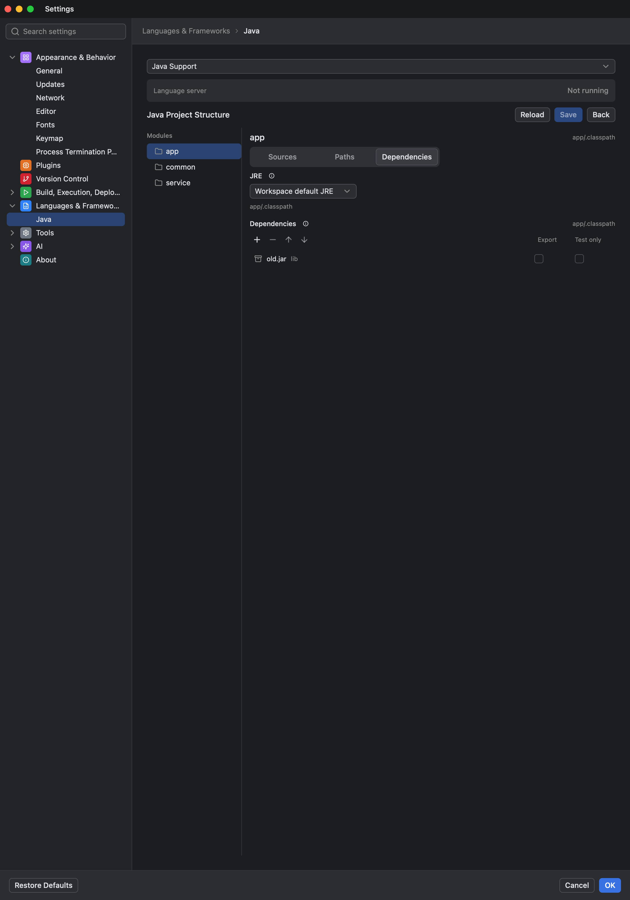
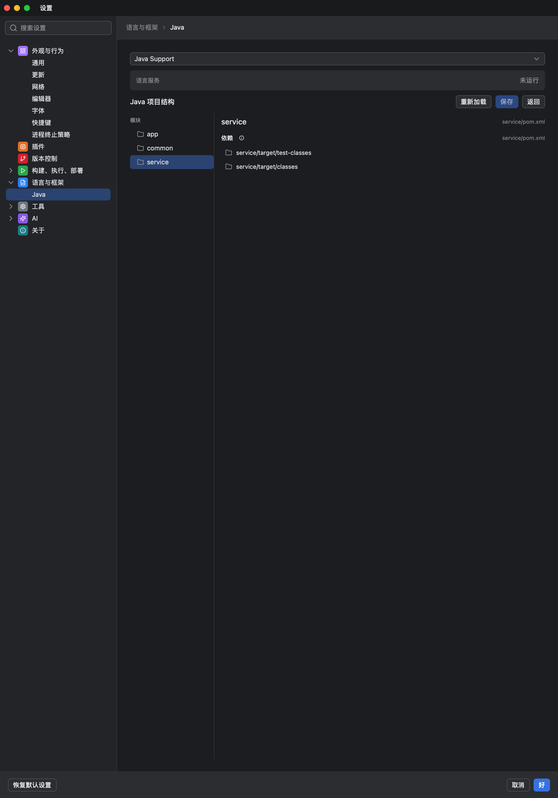

# Java 项目结构（4.0.0）

对标 IntelliJ IDEA 的“项目结构 → 模块”：在“语言与框架 → Java”页点击“读取项目结构”，左侧列出工作区里的每个模块，右侧按“源 / 路径 / 依赖”三个标签页逐个配置（[1lck/Lithe-IDEA#2086](https://github.com/1lck/Lithe-IDEA/issues/2086)）。

| 源文件夹 | 依赖 |
| --- | --- |
|  |  |
| Dependencies (English, dark) | Maven 模块（只读） |
|  |  |

## 哪些模块可以编辑

| 模块 | 来源 | 能改什么 |
| --- | --- | --- |
| Eclipse 工程（有 `.classpath`） | 模块自己的 `.classpath` | 源文件夹（可标“测试”）、输出文件夹、JRE、依赖（JAR/ZIP、类文件夹、库容器、其他模块），每项可标“导出”“仅测试” |
| Maven、Gradle 模块 | `pom.xml` / `build.gradle(.kts)` | 只读，显示 JDT 解析出的完整类路径（含测试依赖），请在构建文件里修改 |
| 没有 `.classpath` 的普通文件夹 | `.vscode/settings.json` | 仍在“引用的库”分组里编辑引用的 JAR 和源码文件夹 |

IntelliJ IDEA 工程、Eclipse 容器的解析结果仍在只读的“工程模型”分组里，见 [project-models.md](project-models.md)。

## 依赖怎么添加

“+”菜单按种类添加：

- **JAR 或 ZIP**、**类文件夹**：打开系统文件选择器。选中的路径在模块文件夹内时写成相对路径，否则写成正斜杠的绝对路径（Eclipse 的写法）。
- **库**：从 JUnit 4/5、Web App Libraries、EAR Libraries，以及工作区其他模块已经用到的容器（用户库、Server Runtime 等）中选择。
- **模块依赖**：从工作区的其他 Eclipse 模块中选择，写成 `/项目名`，新加的项带 `combineaccessrules="false"`，与 Eclipse 一致。
- **类路径变量**：只保留和排序文件里已有的变量项；变量本身由 Eclipse 定义，这里不新增。

JRE 下拉框可选“工作区默认 JRE”或 JavaSE-1.8/11/17/21/25 执行环境，执行环境对应“工具链”里匹配的 JDK。

## 保存时保留什么

只有点击“保存”才写文件，外部修改会要求重新读取。保存只改页面管理的条目，按种类和路径匹配已有条目，所以：

- 源码附件（`sourcepath`）、Javadoc 位置、访问规则等页面不显示的属性原样保留；
- 注释和页面不显示的条目留在原位置，新条目按页面顺序依次占用原来的位置；
- 输出文件夹留空表示删除 `output` 条目，JDT 使用默认的 `bin`。

条目路径为空、超过 4096 字节或单个列表超过 256 项的 `.classpath` 无法完整显示，这类模块只读，避免保存时丢项。

## 验证

`scripts/compiler/test-module-structure.mjs` 用真实 JDT LS 打开两个 Eclipse 工程和一个 Maven 模块：检查读取页面不写任何项目文件、Maven 模块只读并带解析出的类路径；再通过页面添加模块依赖（导出）、工作区外的 JAR、新的源文件夹并修改输出文件夹，确认写回的 `.classpath` 保留注释和源码附件，JDT 随后编译成功，class 落在新的输出文件夹；插件包和 JDT LS 安装不变。`scripts/compiler/visual.mjs` 用宿主 Viva 无头窗口渲染同一份真实投影（中英、明暗）。

## Eclipse WTP Web Facet

带有 `.classpath` 的 Eclipse 工程如果同时存在 `.settings/org.eclipse.wst.common.project.facet.core.xml` 中的 `jst.web`，项目结构页会额外显示「Web Facets」分组。可在独立来源中选择 Dynamic Web Module 版本，再点击保存。下拉框只列出与同一文件中 `jst.java` 版本兼容的版本（例如 Java 8 最高到 5.0，6.0 需要 Java 11，6.1 需要 Java 17），与 Eclipse 自己的 Facet 约束一致。保存前宿主检查原始版本，写回时仅编辑此 XML 文件中的现有 `jst.web` 版本，保留其他 Facet、注释、属性顺序和 Eclipse 的 `/>` 写法，版本控制里只看到这一处改动。

文件中有重复的 `jst.web`、DOCTYPE 或其他无法安全编辑的内容时，这个模块不显示 Web Facet 来源，模块本身和项目结构页其他部分照常显示，后端对本次读取上报一次 `webFacetUnreadable` 降级。

这不是 Web Facet 的完整编辑器：不会自动创建缺失的 Facet，不改 WTP `.component` 的 Web 根和部署装配，也不写 IDEA `.iml`；后者仍为只读工程模型。
